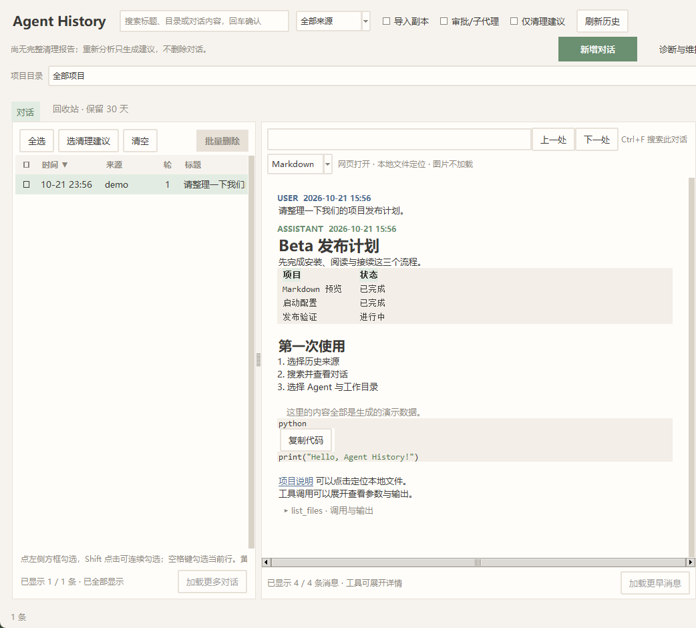

# Agent History

[English](README.en.md) · **0.1.0-beta.1** · MIT 开源协议

[下载 beta 源码包](https://github.com/Re-Lyz/agent-history/releases/tag/v0.1.0-beta.1) · [双平台 CI 验证](https://github.com/Re-Lyz/agent-history/actions/runs/38031469719)

把本机 Codex 与 Claude Code 的历史集中到数据库：搜索、阅读 Markdown、选择启动命令和工作目录，然后在独立终端接续对话。支持单 Agent、多个账号及不同 Codex 登录连接。Agent 的安装、登录和模型调用由用户自己的 CLI 完成。



截图来自实际桌面 UI，内容和路径均为生成的演示数据。生成方法见 [截图说明](docs/demo.md)。

## 快速开始

需要 **Python 3.11+、Tk、SQLite FTS5（含 trigram tokenizer）**。建议新建虚拟环境；Windows Python 需包含 Tcl/Tk，Linux 可先安装发行版的 Python、venv 和 Tk 包。在克隆或解压后的项目目录运行：

```text
git clone https://github.com/Re-Lyz/agent-history.git
cd agent-history
python -m venv .venv
```

Windows PowerShell 激活：`.\.venv\Scripts\Activate.ps1`；Linux 激活：`source .venv/bin/activate`。不使用激活脚本也可直接执行虚拟环境里的 Python。接着运行：

```text
python -m pip install -r requirements-ui.txt
python install.py --dry-run
python install.py
```

从开始菜单／Linux 应用菜单打开 **Agent History**，或直接运行 `python history_ui.py`。安装后入口使用独立来源配置；直接源码运行默认读取仓库上级目录的配置，可用 `AGENT_HISTORY_SHARED_ROOT` 指定来源配置目录。首次向导选择已有 `.codex`／`.claude` 或自定义 home，保存并索引，再选对话查看内容。程序未安装也可阅读已有历史。

若要接续，先在终端确认 `codex --version` 或 `claude --version` 可运行并完成登录。右栏选择启动入口、工作目录，核对预览后点“打开终端并继续”。没有 `codex1` 等个人快捷命令也可使用；自定义脚本、程序路径和参数可在“启动配置”管理。

如果右栏提示启动进程已结束、等待核验，选中该对话后点“重试同步／刷新续聊”。重试会重新检查进程和原生写锁，验证已保存内容后解除占用；仍在运行的任务会计入待处理项。存在独立分支、缺失文件或校验失败时会保留现状，具体原因见“启动记录与诊断”。

开始新对话时，点主窗口的“新增对话”，选择启动命令和工作目录，核对预览后点“打开终端并新建”。历史为空时也可使用，模型沿用该命令的配置；固定目录配置沿用其目录策略。未完成登录的 Agent 在终端处理登录。终端退出后自动采集已接入来源的历史，运行期间也可通过“刷新历史”查看已保存内容；关闭查看器不结束终端。

完整流程、常见缺依赖问题、可选 MCP／Hook／后台任务见 [首次使用](docs/first-use.md)。基础安装只登记查看器入口；`--desktop` 可选桌面快捷方式。默认安装目录为 `~/.local/share/agent-history`，支持 `--prefix` 和 `--python`；源码 ZIP 需要 Python，安装入口指向这份源码，解压目录应保留。

## 功能

- 标题／正文／目录／来源搜索，项目筛选，点击列标题排序；左列显示纯标题，模型、版本和分支信息放在右栏。列表在后台加载，连续筛选合并为最后一次请求，排序和加载更多复用已有结果。中栏 Markdown、代码高亮、代码复制、全文命中定位和分批加载；本地 Markdown 链接可点击定位文件，支持绝对路径、相对会话工作目录的路径及 file:// 链接。
- 工具调用与输出支持展开、收起和独立滚动，详情控件在展开时才创建；右栏独立滚动，标题、会话信息和命令预览可选中文字后按 Ctrl+C 或右键复制。历史内容不执行脚本、不自动加载网络图片。
- 修改逻辑对话名称，关联版本共享名称；不改写原生标题。管理启动入口的程序、参数、显示名称、收藏、顺序和默认项。
- 新增对话可选择内置或自定义启动命令；提供目录选择、命令预览／复制、启动检查及失败重试，支持仅新会话配置。
- 单主会话接续：同一逻辑对话只允许一个受管理的 Agent 启动；同连接复用原生 ID，跨连接／Agent 结束并验证后保留最新目标、清理已接替的旧文件。异常保留文件供重试；已有并行分支须先合并。修订备份和附件另存，详见 [接续说明](docs/conversation-handoff.md)。
- 删除进入保留 30 天的回收站，支持恢复；还原前后校验转录完整性。恢复与到期清理互斥，未完成恢复的条目保留供重试；活跃会话、原生写锁和被依赖的分支受保护。
- 可选 MCP 提供 `search_history`、`list_sessions`、`read_session`；核心 CLI／MCP 使用 Python 标准库。
- “诊断与维护”提供只读环境检查、脱敏报告、配置快照和恢复，以及更新／卸载预览；恢复不回滚历史数据库或删除记录。详见 [维护说明](docs/maintenance.md)。
- 原生会话已打开但启动记录未接管时显示实际保护状态。未接管且空闲的启动可取消；同终端切换 `/resume` 后，可核对并同步已切出的原对话，终端继续运行、文件保留。未确认原生接管或写锁未释放时维持保护。

## 兼容范围与 beta 限制

| 场景 | 本地验证结果 |
|---|---|
| Windows，Python 3.12，Codex CLI 0.159.2 | 桌面、安装／卸载、合成回归和原生 list／resume／内容读回通过 |
| Ubuntu 20.04／WSL2／WSLg，Python 3.12.2，xterm，Codex CLI 0.159.2 | 桌面、终端启动、安装／卸载、合成回归、无桌面 CLI 和原生恢复通过 |
| Claude 历史格式及跨 Agent 转换 | 合成 JSONL／接续关系通过；实际 Claude CLI 登录和交互恢复未验证 |
| 其他 Linux 发行版／桌面终端、原生 Wayland、真实 systemd 调度 | 尚未实测 |
| macOS | 尚未支持／验证 |

Python 3.11 是最低运行要求；完整本地回归使用 3.12。GitHub windows-latest／Ubuntu 22.04 的回归、源码包检查、临时用户首次使用及四项零请求原生 Codex 检查均已通过，见 [Actions 实际结果](https://github.com/Re-Lyz/agent-history/actions/runs/38031469719)。这不代表真实 Claude 交互或全部 Linux 桌面已验证。

原生 Codex 恢复涉及 CLI 内部存储格式，**升级 Codex 后先运行隔离兼容检查**。跨 Codex 副本可保留原记录，但外部附件仍依赖原路径，加密内容可能无法被另一服务解码。Claude ↔ Codex 转换保留文字和工具摘要，省略图片、附件、隐藏推理与执行状态，不重放工具。工具全文可按需查看，全文索引只保留工具摘要。详细范围见 [发行说明](docs/beta-release.md)、[Linux](docs/linux.md)、[原生导入](docs/native-import.md) 和 [跨平台接续](docs/conversation-handoff.md)。

## 配置、数据与升级

源码与运行数据分离。安装默认的来源配置在安装目录 `config/`；索引与偏好在 `~/.agent-history/`，包括 `history.db`、启动配置、任务报告、回收站、快照、备份和日志。Agent 原始 home 由用户选择，认证文件不复制到仓库。`AGENT_HISTORY_SHARED_ROOT` 改变来源配置位置，`AGENT_HISTORY_HOME` 改变数据目录。不要将运行目录、真实历史或诊断原文提交 Git。

更新源码后重开 UI，并重启长期运行的 MCP。移动源码／解释器时重新运行安装器更新入口；已有个人环境可使用 `--shared-root 配置目录`。卸载：

```text
python install.py --prefix 原安装目录 --uninstall --dry-run
python install.py --prefix 原安装目录 --uninstall
```

卸载只撤销未被用户修改的登记；历史、来源配置和备份保留。不要用旧原生数据库备份覆盖已新增的对话。详见 [首次使用](docs/first-use.md)。

## 命令行、开发与反馈

在仓库根目录使用所选 Python，无需固定安装路径：

```text
python agent_history.py sessions --tool codex
python agent_history.py search "关键词"
python agent_history.py show 会话ID --tail 20
python trash.py list
python launch_profiles.py list
python -m unittest discover -s tests -t . -v
```

CLI 默认来源配置位置与直接源码 UI 一致；可传 `--shared-root 配置目录`。导入会写入目标 home，删除会移动来源文件，操作前请核对范围。高级入口见 [命令帮助](HELP.md)、[启动配置](docs/launch-profiles.md)、[测试](tests/README.md)、[贡献指南](CONTRIBUTING.md)、[安全反馈](SECURITY.md)、[TODO](docs/roadmap.md)。

## 许可证

[MIT](LICENSE)：允许使用、修改、分发、再授权及商业使用，副本或软件的重要部分需保留版权和许可声明。第三方组件保留自己的许可证，见 [NOTICE](NOTICE.md)。
